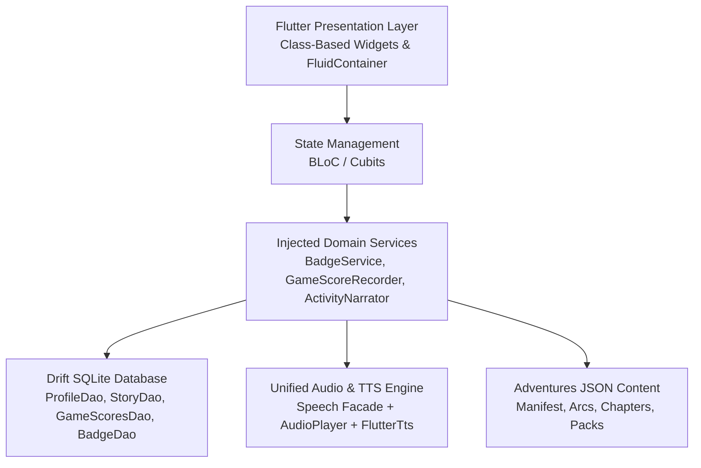

# 🦁 Kidzoo — Play, Learn & Discover! 🚀

<div align="center">


**An engaging, interactive learning universe designed to spark curiosity, boost cognitive skills, and nurture creativity in children.**

Developed and owned by **Youssef Alaa ([Annotex])**

[](https://flutter.dev)
[](https://dart.dev)
[](https://developer.android.com)
[](pubspec.yaml)
[](LICENSE)
[](#-asset--performance-optimization)
[](#-local-persistence--offline-first)
[](#-multilingual--voice-narration)

[Features](#-key-features--modules) • [Tech Stack](#-tech-stack--architecture) • [Getting Started](#-getting-started) • [Optimization](#-asset--performance-optimization) • [Release Notes](#-release-notes-v1024) • [License](#-license--intellectual-property)

---

</div>

## 🌟 About Kidzoo

**Kidzoo** is an open, child-first digital playground and interactive educational companion created by **Youssef Alaa (Annotex)**. Designed with developmental psychology principles, Kidzoo turns early childhood learning into a vibrant quest filled with playful animal companions, brain-teasing puzzles, artistic exploration, and story-driven adventures.

### 💖 Core Philosophies
- **Joyful Discovery**: Learning without pressure. Interactive visual and auditory feedback loops encourage positive reinforcement rather than penalties.
- **Adaptive No-Fail Learning**: Smart difficulty scaling and guided hints ensure young children never encounter frustrating dead-ends.
- **100% Kid-Safe & Private**: Completely ad-free, tracker-free, and playable entirely offline with on-device SQLite storage.
- **Bilingual Experience**: Native English and Arabic support with full Right-to-Left (RTL) typography and localized voice narration.

---

## ✨ Key Features & Modules

Kidzoo organizes content into three primary pillars accessible from an intuitive carousel launcher: **Adventures**, **Education**, and **Games**.

```
                           ╔═════════════════════════╗
                           ║     Kidzoo Universe     ║
                           ╚═════════════════════════╝
                                       │
        ┌──────────────────────────────┼──────────────────────────────┐
        ▼                              ▼                              ▼
  🗺️ ADVENTURES                  📚 EDUCATION                   🎮 GAMES & PUZZLES
  • Lost Pages Story Quest       • Numbers & Math               • Memory & Color Match
  • Jungle, Market, Ocean, Stars • Alphabet & Phonics           • 2048 & Dots & Boxes
  • Adaptive Activity Engines    • Animal Names & Feeding       • Maze & Paddle Bounce
  • Interactive Storybook Hub    • Shapes, Colors, Flags        • DrawLab Creative Canvas
```

### 🗺️ Interactive Storylines & Challenges (New in v1.0.2!)
Step into **Kidzo Adventures: The Lost Pages**, where children embark on a whimsical journey across themed worlds to recover scattered storybook pages:
- **Jungle Sanctuary**: Discover hidden watchers, count friendly critters, and sort tropical fruits.
- **Bustling Market**: Weigh orders, deliver groceries, and mend store signs with friendly characters.
- **Deep Ocean**: Follow glowing currents, test float-or-sink physics, and illuminate deep-sea turtles.
- **Starlit Skies**: Reconnect constellations, follow celestial paths, and illuminate the night sky.
- **Adaptive Activity Engine**: Driven by dynamic JSON manifests (`assets/adventures/`) using modular engines: Counting, Sorting, Drag & Drop, Pattern Recognition, Multiple Choice, and Hidden Clues.
- **The No-Fail Ladder (`NoFailCoach`)**: Automatic scaffolded hints guide young learners toward success without frustration.

### 🦁 Animal Kingdom & Sound Discovery
- **High-Fidelity Animal Sounds**: Real, authentic animal calls and crystal-clear pronunciations bring lions, elephants, sheep, cows, giraffes, and birds to life.
- **Feed The Animals**: Interactive drag-and-drop nutrition challenges teaching kids what each animal eats.
- **Animal Name & Habitat Quizzes**: Visual and auditory recognition quizzes with instant praise celebrations.

### 🛡️ Child-Safe, Accessible & Kid-Friendly UI
- **Ergonomic Touch Targets**: Large buttons, fluid animations, and touch surfaces designed specifically for toddler and preschooler motor skills.
- **High-Contrast Palette**: Vibrant, joyful color schemes maintaining high visual contrast for ease of viewing.
- **Zero Ads & Zero In-App Purchases**: No external trackers, pop-ups, or unintended navigation traps.
- **Responsive Layout (`FluidContainer` & `CustomMQ`)**: Flawless presentation across phones, mini tablets, and large screens in both portrait and landscape.

### 🎨 Creative Expression & Cognitive Brain Games
- **DrawLab**: A pressure-sensitive digital drawing and doodling canvas with custom brushes, cheerful color palettes, and gallery saving.
- **Mind Puzzles**: Slider puzzles (Gazelle, Ghost, and Party blocks), classic 2048, and algorithmic maze navigation.
- **Reflexes & Logic**: Dots and Boxes, Paddle Bounce arcade action, Color Switch reflex tests, and 3D card-flip Memory Match.

### 🔤 Early Childhood Essentials
- **Alphabet & Phonics**: Letter tracing, auditory pronunciation, and missing letter challenges.
- **Numbers & Math**: Object counting, numerical sequencing, and visual arithmetic.
- **Shapes & Colors**: Interactive geometry recognition and color sorting.
- **World Explorer**: Flag guessing and geographical discovery adapted for preschoolers and elementary kids.

### 🏆 Badges & Positive Reinforcement
- **Personalized Kid Profiles**: Custom animal avatars, child names, and age configuration.
- **Achievement Badges**: Real-time badge unlocking with celebratory confetti overlays (`BadgeCelebrationHost`).
- **Drift SQLite Records**: On-device tracking of high scores, chapter progress, and completed storybooks.

---

## 📱 Screenshots & Media Showcase

<div align="center">

| 🏠 Character & Hub Selection | 🗺️ Adventure Map Quest | 🦁 Animal Sound Kingdom |
|:---:|:---:|:---:|
|  |  |  |

| 🧩 Brain Puzzles & 2048 | 🎨 DrawLab Canvas | 🏆 Badge Celebrations |
|:---:|:---:|:---:|
|  |  |  |

> *Place your screenshots under `assets/screenshots/` and update these preview paths for app store showcases.*

</div>

---

## 🛠️ Tech Stack & Architecture

Kidzoo is built on clean architectural principles, strictly adhering to zero mutable global state and reactive state management:

```
lib/
├── core/
│   ├── badges/        # Badge catalog, celebration cubits, and stat readers
│   ├── catalog/       # Injected GameCatalog, GameDescriptors, and surface registries
│   ├── database/      # Drift (SQLite v3) tables, DAOs, and migrations
│   ├── difficulty/    # Tiered difficulty scaling (Easy, Medium, Hard)
│   ├── helpers/       # Dual-engine Speech facade, TTS service, and screen metrics
│   ├── localization/  # Bilingual AppLocalizations (en, ar) with RTL support
│   ├── scoring/       # GameScoreRecorder and progress metrics
│   └── services/      # Injected runtime services and background audio cubits
├── features/
│   ├── Adventure/     # Activity engines, story runner, host screens, and narrative support
│   ├── Alphabets/     # Letter exploration and phonics
│   ├── AnimalQuiz/    # Interactive animal guessing
│   ├── DrawLab/       # Drawing canvas with image export
│   ├── Numbers/       # Counting games and math challenges
│   ├── Profile/       # Kid profile setup and avatar management
│   └── home/          # Carousel character launcher and surface navigation
└── shared/            # Reusable class-based widgets, shells, and UI tokens
```

### 🧩 Architectural Highlights


### 🔊 Audio & Speech Engine
- **Unified `Speech` Facade**: Wraps on-device TTS (`flutter_tts`) and cloud synthesis fallback (`azure_tts.dart`).
- **Concurrent Audio Streams**: Employs distinct `AudioPlayer` channels for spoken narrations, background musical themes (`MusicCubit`), and short sound effects—ensuring speech prompts never cut off game sound effects.
- **Device Voice Diagnostic**: Integrated Arabic capability survey (`Speech.surveyArabic()`) ensuring natural pronunciation on regional voice engines.

### 💾 Local Persistence & Offline-First
- Powered by **[Drift](https://drift.simonbinder.eu/) (formerly Moor)** compiled against native SQLite.
- Fully typed relational tables for `Profiles`, `GameScores`, `StoryNodeProgress`, `StoryChapterProgress`, `StoryRewards`, `ActivityAttempts`, and `Badges`.
- 100% offline capability: Zero cloud dependencies required for child gameplay.

---

## ⚡ Asset & Performance Optimization

To deliver buttery-smooth 60 FPS gameplay on budget mobile devices and keep the app bundle under **80 MB**, Kidzoo implements rigorous engineering optimizations:

| Optimization Strategy | Implementation Details | Result |
|:---|:---|:---:|
| **WebP Asset Encoding** | High-density PNG/JPG assets converted to modern WebP format across backgrounds, characters, and UI icons. | **~65% size reduction** |
| **Android R8 & Minification** | Enabled `isMinifyEnabled = true` and `isShrinkResources = true` in release builds. | **Dramatically stripped dead code** |
| **Tailored ProGuard Configuration** | Custom rules in `proguard-rules.pro` safeguarding reflection in Drift/SQLite3, `flutter_local_notifications`, `flutter_tts`, and `audioplayers`. | **Zero runtime crashes** |
| **Core Library Desugaring** | Enabled Java 17 desugaring (`desugar_jdk_libs:2.1.4`) to support modern temporal APIs across older Android versions (SDK 21+). | **Broad device compatibility** |
| **Audio Compression** | Audio bites encoded as compressed 44.1kHz MP3/WAV, streamed asynchronously with zero UI jank. | **Instant playback** |

---

## 🚀 Getting Started

### 📋 Prerequisites
- **Flutter SDK**: `>= 3.5.1` (Tested on Flutter 3.47+)
- **Dart SDK**: `^3.5.1`
- **Android Studio / Android SDK**: `compileSdk 36`, `targetSdk 36`, `minSdk 21` (Java 17 JDK)
- **Xcode** (for iOS builds): iOS 12.0+

### 💻 Installation & Setup

1. **Clone the repository**:
   ```bash
   git clone https://github.com/annotex/kidzoo.git
   cd kidzoo
   ```

2. **Install Flutter dependencies**:
   ```bash
   flutter pub get
   ```

3. **Generate Drift Database & Code Bindings**:
   ```bash
   dart run build_runner build --delete-conflicting-outputs
   ```

4. **Verify Environment & Connected Devices**:
   ```bash
   flutter doctor -v
   ```

5. **Run the App**:
   ```bash
   flutter run
   ```

### 🧪 Running Tests
Kidzoo maintains a comprehensive test suite covering logic, database DAOs, catalog integrity, audio selectors, and adventure content schema:
```bash
# Run all unit and widget tests
flutter test

# Run adventure content verification (validates all JSON manifests)
flutter test test/adventure/
```

### 📦 Building for Production

#### Build Android Release App Bundle (Google Play Store)
```bash
flutter build appbundle --release
```

#### Build Android Release APK (Direct Distribution)
```bash
flutter build apk --release --split-per-abi
```

> [!TIP]
> Ensure your `key.properties` file is configured in `/android` pointing to your release keystore before executing production builds.

---

## 📢 Release Notes: Version 1.0.2+4

- 🗺️ **Kidzo Adventures Launched**: Brand new story-driven quest mode replacing the legacy static level map. Includes the complete **Lost Pages** arc with Jungle, Market, Ocean, and Stars chapters.
- 📉 **App Size Optimized (<80MB)**: High-resolution images migrated to modern WebP format, alongside Android R8 full-code minification and resource shrinking.
- 🛡️ **Enhanced ProGuard Rules**: Custom protection added for Drift SQLite3, local notification desugaring, and audio players to prevent minification stripping.
- 🗣️ **Smart Sorting & Voice Labels**: Interactive activities now announce verbal labels and contextual hints for bins and drop zones.
- 🎨 **Adaptive Splash & Theme Polish**: Polished background resolver guaranteeing seamless splash and canvas rendering across phone and tablet aspect ratios.

---

## 📜 License & Intellectual Property

**Copyright © 2024 - 2026 Youssef Alaa (Annotex). All Rights Reserved.**

This software, including all source code, binaries, graphical illustrations, character designs, animations, WebP/PNG assets, sound effects, audio voiceovers, story manifests, and documentation, is **confidential and proprietary**.

- **Unauthorized copying, distribution, decompilation, modification, or commercial exploitation is strictly prohibited.**
- For full legal terms and conditions, consult the official [LICENSE](LICENSE) file located in the project root.
- For business inquiries, licensing, or commercial partnerships, contact: **Youssef Alaa (Annotex)**.

---

<div align="center">

Crafted with ❤️, 🎨, and 💡 by **Youssef Alaa (Annotex)** for curious young minds.

</div>
